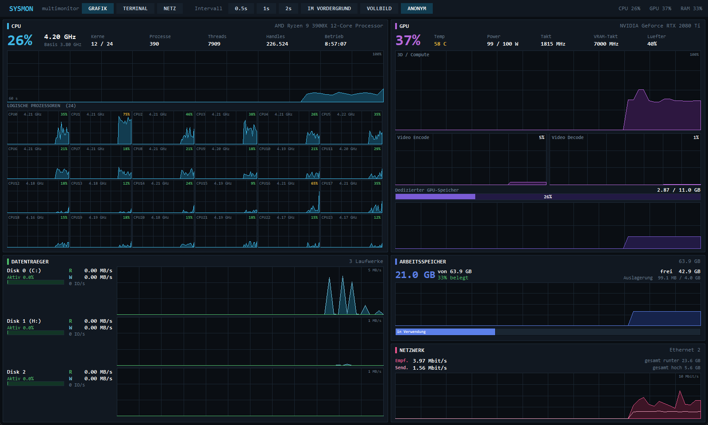
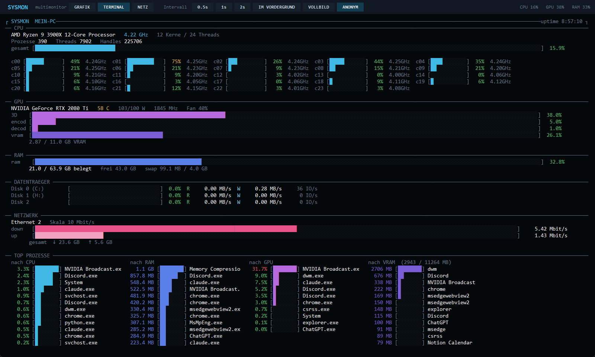
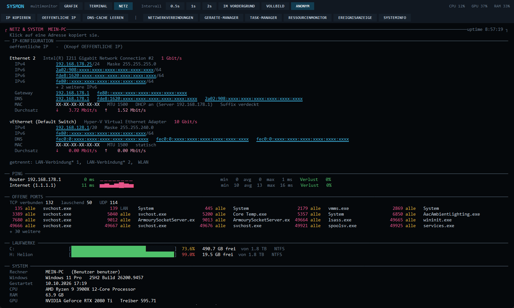

# SysMon — Multimonitor (App 1)

Task-Manager-Ersatz auf **einem** Bildschirm: alle 24 logischen CPU-Kerne mit
Takt pro Kern, die komplette GPU-Sektion (3D, Encode, Decode, VRAM, Temp, Power,
Takt, Lüfter), RAM, alle Datenträger mit MB/s und IO/s sowie Netzwerk — plus eine
zweite, komplett andere Optik im Linux-Terminal-Stil und eine Netz-&-System-Ansicht
mit IP-Konfiguration, Ping und nützlichen Werkzeugen.



<table>
<tr>
<td></td>
<td></td>
</tr>
<tr>
<td align="center"><b>TERMINAL</b> — mit Top-Prozessen nach CPU, RAM, GPU und VRAM</td>
<td align="center"><b>NETZ</b> — IP-Konfiguration, Ping, Ports, Laufwerke, System</td>
</tr>
</table>

## Installation

Läuft nur unter **Windows 10/11**. Gebraucht wird
[Python 3.10 oder neuer](https://www.python.org/downloads/) — beim Installieren
„Add python.exe to PATH" anhaken. Danach einmalig:

```bash
pip install -r requirements.txt
```

## Starten

```bash
SysMon.bat
```

(oder `python app.py` — braucht nur `psutil`, GUI ist tkinter, alles andere direkt
über Windows-/NVIDIA-DLLs)

## Drei Ansichten

| | |
|---|---|
| **GRAFIK** | Task-Manager-Optik: gefüllte Verlaufskurven, 60-Sekunden-Fenster, ein Mini-Graph pro logischem Prozessor inkl. dessen aktuellem Takt |
| **TERMINAL** | monospace ASCII-Balken (`████░░░░`) mit denselben Metrikfarben, dazu Top-Prozesse nach CPU, RAM, GPU und VRAM (MB je App) nebeneinander |
| **NETZ** | IP-Konfiguration aller Adapter (IPv4/IPv6, Maske, Gateway, DNS, DHCP, MAC, Linkspeed, Durchsatz), Live-Ping zu Router und Internet mit Verlauf, offene Ports mit Programm, Laufwerksbelegung, System (Windows-Version, Mainboard, BIOS, GPU-Treiber). Oben Knöpfe: IP kopieren, öffentliche IP abfragen, DNS-Cache leeren und Windows-Werkzeuge öffnen (Netzwerkverbindungen, Geräte-Manager, Task-Manager, Ressourcenmonitor, Ereignisanzeige, Systeminfo). Klick auf eine Adresse kopiert sie. |

## Tasten

| Taste | Funktion |
|---|---|
| `G` / `T` / `N` / `Leertaste` | Grafik / Terminal / Netz / weiterschalten |
| `1` `2` `3` | Intervall 0,5 s / 1 s / 2 s |
| `O` | Fenster immer im Vordergrund |
| `A` | Anonym-Modus: verdeckt Rechner-/Benutzername, MAC, IPv6 und öffentliche IP — für Screenshots |
| `F11` / `Esc` | Vollbild an/aus — auf dem Monitor, auf dem das Fenster gerade liegt |
| `Strg+Q` | beenden |

Fenstergröße, Ansicht, Intervall und „im Vordergrund" werden beim Beenden in
`sysmon.json` gespeichert.

## Farben

Wie im Task-Manager: CPU blau (bei Intel-Hybrid-CPUs P-Kerne blau, E-Kerne grün), RAM blau-violett, Datenträger grün (Lesen) / hellblau
(Schreiben), Netzwerk pink, GPU violett, VRAM dunkelviolett. Prozentzahlen werden
zusätzlich grün → gelb → rot eingefärbt.

## Aufbau

| Datei | Inhalt |
|---|---|
| `app.py` | Fenster, Kopfleiste, Layout, Tastenkürzel |
| `sampler.py` | drei Hintergrund-Threads: schnelle Werte (CPU/RAM/Disk/Netz/Takt), GPU, Prozessliste |
| `winapi.py` | direkte Windows-/NVIDIA-Schnittstellen (PDH, NVML, ntdll) — siehe Performance |
| `views.py` | die fünf Grafik-Panels |
| `terminal.py` | die Terminal-Ansicht (und die Text-Basis für NETZ) |
| `netview.py` | die NETZ-Ansicht mit Werkzeugleiste |
| `privacy.py` | Anonym-Modus |
| `netinfo.py` | Daten für NETZ — eigene Threads, laufen nur, solange die Ansicht offen ist |
| `draw.py` | Zeichen-Helfer im Retained-Mode (`Scene`) |
| `theme.py` | Farbschema |

## Performance

Ein Bild kostet **~6 ms** (Grafik) bzw. **~8 ms** (Terminal) — vorher waren es über
200 ms, was als Ruckeln sichtbar war. Vier Dinge waren dafür nötig:

| Problem | vorher | jetzt |
|---|---:|---|
| `psutil.process_iter` mit Attributen (macht pro Prozess einen kompletten System-Snapshot) | 2 500 ms | **7 ms** — alles aus einem `NtQuerySystemInformation` (`winapi.ProcTable`) |
| Canvas-Items bei jedem Bild neu erzeugen (~0,2 ms pro Item) | 215 ms | **1,5 ms** — `draw.Scene` legt jedes Item einmal an und schickt danach nur Änderungen |
| GPU-Werte über den Subprozess `nvidia-smi` | ~150 ms | **5 ms** — `nvml.dll` direkt (`winapi.Nvml`) |
| Terminal-Text Segment für Segment einfügen | ~250 Tcl-Aufrufe | **~15** — ein String, dann pro Farbe ein `tag_add` |

Der Takt je Kern kommt aus dem PDH-Zähler `% Processor Performance` mal Basistakt —
dieselbe Quelle wie im Task-Manager, deshalb stimmen die GHz-Werte exakt überein.
Die GPU-Last je Prozess kommt aus dem Zähler `GPU Engine(*)`, ebenfalls genau wie dort.
Der VRAM je Prozess kommt aus `GPU Process Memory(*)\Dedicated Usage` — das ist die
Spalte „Dedizierter GPU-Speicher" im Task-Manager (NVML kann das unter Windows nicht).

## Hinweise

- Der Takt pro Kern steht neben dem Kernnamen in jeder Mini-Kachel (Grafik) bzw.
  hinter jedem Balken (Terminal).
- „Aktiv %" der Datenträger kommt aus `read_time`/`write_time` — bei NVMe sind das
  realistisch < 1 %, auch wenn viele MB/s fließen. Deshalb stehen MB/s und IO/s daneben.
- GPU-Werte brauchen eine NVIDIA-Karte (`nvml.dll` kommt mit dem Treiber); fehlt sie,
  wird auf `nvidia-smi` zurückgefallen, ohne Karte bleibt nur das GPU-Panel leer.
- Die Prozessliste ist auf die Gesamt-CPU normiert (wie im Task-Manager), nicht auf
  einen Kern; der RAM-Wert ist der private Arbeitssatz — ebenfalls wie dort.
- Ist das Fenster zu schmal für vier Top-Prozess-Spalten nebeneinander, werden sie
  umgebrochen (z. B. 2 × 2) statt abgeschnitten — die VRAM-Spalte bleibt immer sichtbar.
- P-/E-Kerne kommen aus `GetSystemCpuSetInformation` (EfficiencyClass je logischem
  Prozessor). Bei CPUs ohne Hybrid-Aufbau (AMD, ältere Intel) bleibt alles blau.
- Die IP-Konfiguration kommt direkt aus `GetAdaptersAddresses` (~7 ms statt ~6 s über
  PowerShell), gepingt wird über `IcmpSendEcho` — ohne `ping.exe`.
- Die öffentliche IP wird nur auf Knopfdruck bei `api.ipify.org` abgefragt, nie
  automatisch. Gepingt werden Router, DNS-Server und `1.1.1.1` — nur in der NETZ-Ansicht.
- Bei minimiertem Fenster wird gar nicht gezeichnet.

## Mitwirkende

- **Maik Mikosch** ([@mikoschmaik2003-code](https://github.com/mikoschmaik2003-code)) — Idee, Anforderungen, Tests
- **Claude** (KI-Assistent von [Anthropic](https://www.anthropic.com)) — Programmierung

Die Screenshots sind im Anonym-Modus entstanden.
